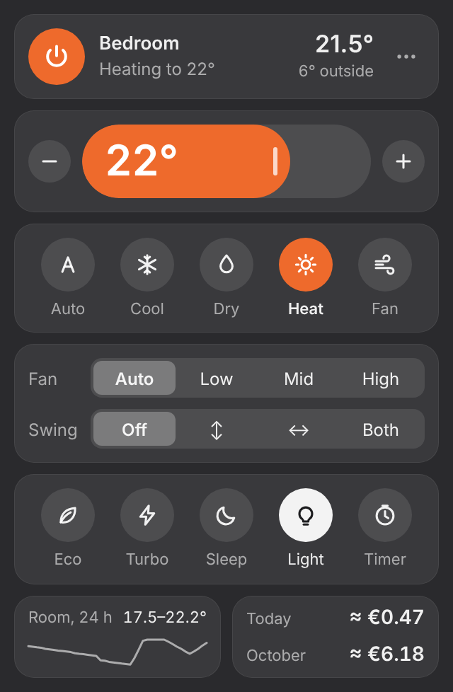
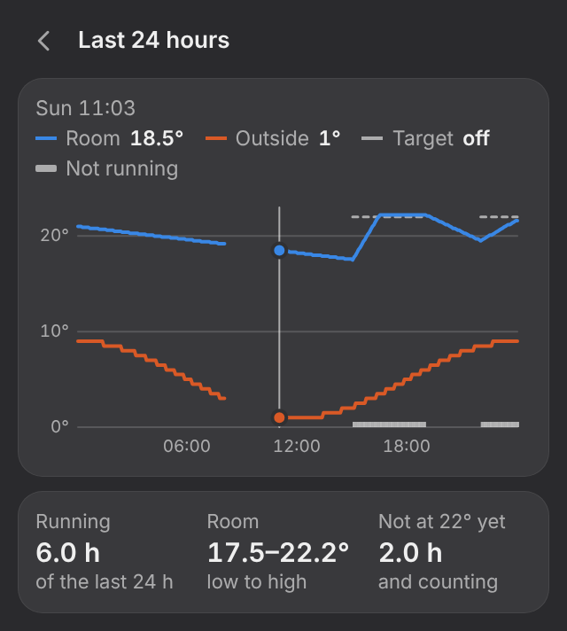
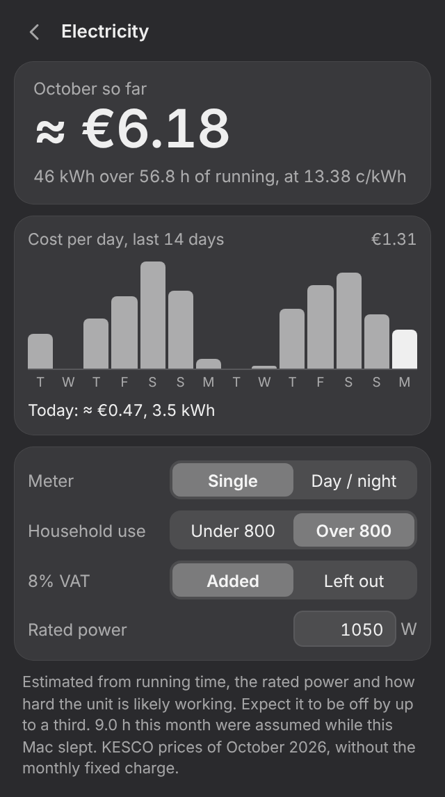

# MideaBar

Menu bar control for a Midea air conditioner (the ones set up with the SmartHome /
MSmartHome app). It talks to the unit directly over your Wi-Fi, so it keeps working
when Midea's cloud is slow or down.

<p>
  
  
  
</p>

Screenshots show sample data. More in [`docs/`](docs).

> An independent hobby project. Not affiliated with or endorsed by Midea or KESCO.
> Built for one household's unit and tested mostly against a simulator; expect rough
> edges on other models.

## Install

There is no signed download. Build it on your own Mac (Apple Silicon or Intel, macOS 13+,
Node 22.12+):

```bash
git clone https://github.com/jashuari/midea-bar.git
cd midea-bar
npm install
npm run package          # creates out/MideaBar-darwin-<arch>/MideaBar.app
```

Move `MideaBar.app` to your Applications folder and open it. On first launch it looks
for the unit, asks macOS for Local Network access, and asks once for the SmartHome
sign-in of the account that owns the unit (step 2 of "How it works" explains why).

- Click the menu bar icon: power, a draggable temperature slider (half degrees where the
  unit takes them), mode, fan, swing, eco, turbo, sleep, the unit's display light, and an
  off timer. Room and outside temperature sit at the top, power draw at the bottom.
- **What it costs:** today's and this month's electricity cost at KESCO's household
  prices, with a 14-day chart. Click the cost row to open it and to set your meter type,
  whether the household passes 800 kWh a month, VAT, and the unit's rated power.
- **Last 24 hours:** room, outside and target temperature on one chart, with how long
  the unit ran and how long the room took to reach the target. Click the small room
  chart under the controls.
- **Notifications:** a fault, a filter that needs cleaning, the unit left on for eight
  hours, or an hour of heating or cooling with the room going nowhere (usually an open
  window). The same alerts are listed at the bottom of the popover. Switch them off, or
  send a test one, from the right-click menu.
- The menu bar icon shows air coming out of the unit while it runs, next to the target
  temperature.
- Right-click the icon (or the ⋯ button): switch unit, search again, start self-clean,
  beep on/off, open at login, quit.
- Double-click the name to rename the unit. Drag, scroll or use the arrow keys on the
  slider; Esc closes.

## How it works

1. **Discovery.** A UDP broadcast on ports 6445/20086 asks who is a Midea device. If
   nothing answers (a VPN owning the default route is the usual reason), every address
   on the local /24 is asked directly.
2. **Pairing, once.** Newer units (protocol V3) encrypt their LAN traffic with a token
   and key that only Midea's cloud hands out, and since 2026 only to the SmartHome
   account that owns the unit (the shared community account the libraries used to rely
   on now gets "system error", see
   [midea-ac-py#482](https://github.com/mill1000/midea-ac-py/issues/482)). So the app
   asks for your SmartHome sign-in once. The password is sent to Midea's own API
   (`mp-prod.appsmb.com`), used for that one request and never written to disk. The
   token and key are stored in `~/Library/Application Support/MideaBar/config.json`
   (readable only by you).
3. **Control.** Everything after that is a TCP connection to the unit on port 6444.

## Credits

The protocol code is [`midea-local`](https://github.com/Torsten85/midea-local) (MIT), a
TypeScript port of [`msmart-ng`](https://github.com/mill1000/midea-msmart), pinned to
0.1.2. It has no dependencies; this app only ever contacts Midea's SmartHome API host.
All of the reverse engineering is the work of Tucker Kern and the msmart-ng contributors.

## Layout

```
src/core/        controller, cloud key fetch, tariffs, usage log, temperature history, alert rules, config store, subnet sweep — no Electron, shared by app and CLI
src/main/        Electron main process (tray, popover window, IPC) and preload bridge
src/renderer/    the popover: plain HTML, CSS and TypeScript
src/cli.ts       `midea` command line tool
scripts/fake-ac.ts   a pretend air conditioner for tests and demos
test/            end-to-end tests against the pretend unit
```

## Develop

```bash
npm install
npm test            # 47 tests against the pretend unit and a stubbed cloud
npm start           # run the menu bar app from source
npm run package     # build out/MideaBar-darwin-arm64/MideaBar.app
```

Try it without touching the real unit:

```bash
npm run fake-ac                                              # terminal 1
MIDEABAR_CONFIG=/tmp/demo.json npm run cli -- scan 127.0.0.1 # terminal 2
MIDEABAR_CONFIG=/tmp/demo.json npm run cli -- set power=on temp=22 mode=cool
```

## Command line

The CLI shares its settings with the app.

```bash
npm run build
node dist/cli.cjs scan --account=you@example.com   # first time; asks for the password
node dist/cli.cjs status
node dist/cli.cjs set temp=23 mode=cool fan=auto
node dist/cli.cjs off
```

## How the cost is worked out

- Prices are in `src/core/tariff.ts`, copied from
  [KESCO's tariff page](https://fatura.kesco-energy.com/Static/TariffGroupPrices) in
  October 2026: single-tariff meter 7.12 c/kWh (12.39 c above 800 kWh a month),
  day/night meter 9.05 / 3.88 c (15.43 / 7.28 c above 800). The regulator revises them
  about once a year; edit that file when it does.
- The 800 kWh block is for the whole household, which the app cannot see. You tell it
  whether you usually pass 800; if you do, the AC is priced at the higher rate, because
  it is the use that pushes you over.
- 8% VAT is added by default. KESCO's page does not say whether its prices include it;
  compare with a bill and switch it off if the totals come out high.
- If the unit meters itself, energy comes from its own counter and is exact. The app
  asks every unit once, because some do not advertise it.
- If it does not, energy is estimated: running time × rated power × a load factor
  taken from the gap between room and target temperature (full power when 3° or more
  away, about a quarter once the room is there). Expect up to a third of error.
- Only what the app sees is counted. While the Mac sleeps or MideaBar is closed, an
  unmetered unit that was on before and is on after is assumed to have run throughout
  (at most 24 h); if it has since been switched off, half the gap is counted.
- The log stores energy per day and tariff period in
  `~/Library/Application Support/MideaBar/usage.json`, not money, so changing a setting
  re-prices the history. `midea cost` prints the same figures.

## When it speaks up

Rules live in `src/core/alerts.ts`. Each alert is announced once per occurrence, and
what was announced is saved, so restarting the app does not repeat it.

| Alert | When | Repeats |
|---|---|---|
| Fault | the unit reports a fault code | when the code changes or comes back |
| Filter | the unit raises its filter flag | at most once a week |
| Left on | on without a break for 8 hours | once per stretch |
| Not getting warmer / cooler | heating or cooling for an hour at the same target, still 2° or more away, and less than 0.5° closer than an hour ago | once per target |

The last one is only judged when the app watched the whole hour, so a sleeping Mac
never produces a false alarm. It needs the unit to report room temperature.

## Known limits

- The off timer runs inside this app, not in the unit. The Mac has to be awake and
  MideaBar running when it is due. If the Mac slept more than ten minutes past the
  deadline the timer is dropped rather than switching the unit off at a surprising time.
- Half degrees: units that ignore them answer with the whole number. The app notices
  the first time and offers whole degrees for that unit from then on.
- Energy figures come in two encodings and units do not say which one they use. If the
  watts look absurd, tick "Energy figures look wrong" in the menu.
- Controls a unit does not report (eco, turbo, display light, self-clean, energy) are
  hidden for that unit.
- The packaged app is ad-hoc signed, not notarised. It is meant for your own Mac.
- If you block the unit from the internet at the router, some firmware reboots in a
  loop. Local control does not need you to do that.

## License

MIT. See [LICENSE](LICENSE).
